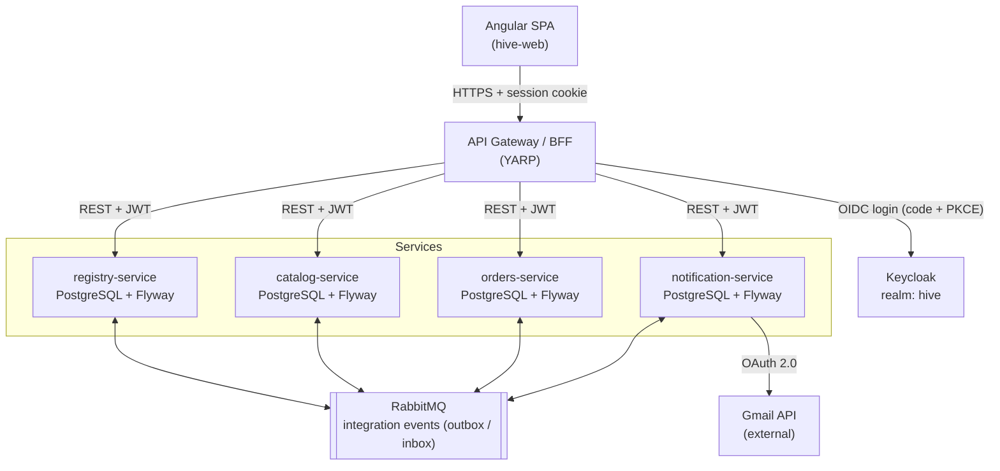

# Hive

A modular business management platform (ERP-style) built with **.NET 10** microservices and **Angular**.

Hive is a learning project: the business domain is intentionally simple, and the complexity lives in the architecture. The goal is to practise an end-to-end enterprise stack: event-driven microservices, OIDC authentication, database versioning, automated testing, containers, CI/CD, external API integrations and LLM features.

> **Status:** 🚧 Milestone 0 (Foundations) in progress. See the [roadmap](#roadmap).

## Table of contents

- [Scope](#scope)
- [Tech stack](#tech-stack)
- [Architecture](#architecture)
- [Services](#services)
- [Data model](#data-model)
- [Service communication](#service-communication)
- [Security](#security)
- [Production readiness](#production-readiness)
- [External integrations](#external-integrations)
- [AI features with Claude Haiku](#ai-features-with-claude-haiku)
- [Repository structure](#repository-structure)
- [Database migrations](#database-migrations)
- [Testing and CI/CD](#testing-and-cicd)
- [Getting started](#getting-started)
- [Roadmap](#roadmap)
- [Decision log](#decision-log)

## Scope

Planned functional modules (**bold** = MVP):

- **Registry**: customers, suppliers, contacts
- **Catalog**: products and services, price lists, VAT rates
- **Orders**: customer orders with lines and statuses
- Inventory: stock levels and movements (phase 2)
- Billing: invoices generated from orders, PDF output (phase 2)
- **Notifications**: transactional email through an OAuth-connected provider

Out of scope for now: multi-tenancy, Kubernetes, mobile app.

## Tech stack

.NET 10 is the current LTS release (supported until November 2028). It was chosen over .NET 8, which reaches end of support on 10 November 2026.

| Area | Choice | Alternative to explore later |
| --- | --- | --- |
| Backend | ASP.NET Core 10, Minimal APIs | — |
| Data access | EF Core 10 (queries and mapping only, no EF migrations) | Dapper for reporting |
| Database | PostgreSQL, one database per service | SQL Server |
| Migrations | Flyway (dedicated container, versioned SQL scripts) | DbUp, Liquibase |
| Messaging | RabbitMQ | Kafka |
| Messaging library | Wolverine (free, built-in outbox) | MassTransit (v9 is commercial) |
| API gateway | YARP | Ocelot |
| Identity | Keycloak (OIDC / OAuth 2.0) | Duende IdentityServer |
| Frontend | Angular (latest stable): standalone components, signals, Angular Material | PrimeNG |
| Validation | FluentValidation | — |
| Observability | OpenTelemetry, Seq / Grafana, health checks | .NET Aspire dashboard |
| Containers | Docker, Docker Compose | Kubernetes (out of scope) |
| CI/CD | GitHub Actions, GitHub Container Registry | Azure DevOps |
| Testing | xUnit, Testcontainers, Playwright, Vitest | — |

MediatR has required a commercial licence since v13. CQRS handlers are therefore hand-written, or built on Wolverine, which also works as an in-process mediator.

**Visual identity:** a beehive theme. Hexagons are the recurring motif (logo, login background, module tiles on the home page, loader), with an amber/honey palette on dark grey and a light/dark variant. It is implemented as a custom Angular Material theme (design tokens) plus reusable hexagon SVGs, without compromising the readability of tables and forms.

## Architecture



The Angular app talks only to the gateway. Every service validates the JWT on its own, owns its database (migrated by Flyway) and exchanges data with the other services only through events.

## Services

Each service owns its data. No service reads another service's database; it uses that service's API or events.

| Service | Responsibility | Publishes | Consumes | Phase |
| --- | --- | --- | --- | --- |
| gateway | Single entry point for the SPA, BFF login, routing, rate limiting | — | — | MVP |
| keycloak | Login, users, roles, token issuing | — | — | MVP |
| registry-service | Customers, suppliers, contacts | CustomerCreated, CustomerUpdated | — | MVP |
| catalog-service | Products, categories, price lists, VAT rates | ProductCreated, PriceChanged | — | MVP |
| orders-service | Customer orders, lines, statuses (draft, confirmed, fulfilled, cancelled) | OrderConfirmed, OrderCancelled | CustomerUpdated, PriceChanged | MVP |
| notification-service | Transactional email via Gmail API (OAuth 2.0), templates | EmailSent, EmailFailed | OrderConfirmed, CustomerCreated | MVP |
| ai-service | LLM features backed by Claude Haiku | — | — | Milestone 4b |
| inventory-service | Stock levels, movements, reservations | StockReserved, StockInsufficient | OrderConfirmed, ProductCreated | Phase 2 |
| billing-service | Invoices from fulfilled orders, PDF, numbering | InvoiceIssued | OrderConfirmed | Phase 2 |

orders-service keeps a minimal local read model of customers and prices, updated from events. An order can be created even when registry-service is down.

## Data model

First draft of the main entities. Audit columns (`created_at`, `created_by`, `updated_at`, `row_version`) exist on every table and are omitted here.

| Service | Table | Key columns |
| --- | --- | --- |
| registry | customer | id (uuid), code, business_name, vat_number, tax_code, email, pec, sdi_code, is_active |
| registry | supplier | id, code, business_name, vat_number, email, is_active |
| registry | address | id, owner_type, owner_id, kind (registered office, shipping), street, city, zip, province, country |
| registry | contact | id, owner_type, owner_id, full_name, role, email, phone |
| catalog | product | id, sku, name, description, category_id, unit, vat_rate_id, is_active |
| catalog | category | id, name, parent_id |
| catalog | price_list / price_list_item | id, name, valid_from, valid_to / product_id, unit_price |
| catalog | vat_rate | id, code, percentage, description |
| orders | order | id, number, customer_id, order_date, status, total_net, total_vat, total_gross |
| orders | order_line | id, order_id, product_id, description, qty, unit_price, discount_pct, vat_pct |
| orders | customer_snapshot / product_snapshot | local read model updated from events |
| notification | email_message | id, to, subject, template, status, provider_message_id, attempts, error |
| notification | oauth_connection | id, provider, account_email, refresh_token (encrypted), expires_at |
| all | outbox_message / inbox_message | managed by Wolverine for reliable delivery |

`pec` and `sdi_code` are Italian e-invoicing fields. Primary keys are UUID v7, generated in the application (`Guid.CreateVersion7()`): they are time-ordered and independent of the database.

## Service communication

Rule of thumb: synchronous (REST) only from the client to the services, asynchronous (events) between services.

- **SPA → gateway → service**: REST/JSON, versioned URLs (`/api/v1/...`), errors as ProblemDetails (RFC 9457), standard paging and filtering.
- **Service → service**: integration events on RabbitMQ. No direct HTTP calls, except justified cases protected by retries and a circuit breaker (`Microsoft.Extensions.Http.Resilience`).
- **Transactional outbox**: the event is stored in the same transaction as the data and published afterwards. This prevents the "order saved, event lost" scenario.
- **Inbox / idempotency**: every consumer records the IDs of processed messages, so a redelivered message never creates duplicates.
- **Contracts**: a shared `Contracts` project containing only versioned event records (`OrderConfirmedV1`).
- **Saga (phase 2)**: order confirmed → stock reserved → invoice issued, with compensation when stock is insufficient.

## Security

Keycloak issues the tokens. The gateway acts as a **Backend for Frontend (BFF)**: it performs the OIDC login (Authorization Code + PKCE), and the browser only receives an `HttpOnly`, `Secure`, `SameSite=Strict` session cookie. No token is ever exposed to JavaScript. Downstream services validate the JWT independently.

- Realm `hive`. Confidential client `hive-gateway` for the BFF, plus one confidential client per service that calls other services (client credentials).
- Realm roles: `admin`, `sales`, `warehouse`, `accounting`, `viewer`. They map to ASP.NET Core authorization policies (`RequireAuthorization("orders.write")`). Angular route guards hide pages by role.
- Secrets: .NET user-secrets locally, environment variables / GitHub Secrets in CI. Never in the repository.
- Mail provider refresh tokens are encrypted at rest with ASP.NET Core Data Protection.
- CORS restricted to the frontend origin. HTTPS everywhere, including local development.

## Production readiness

Before any public deployment, Hive must meet **OWASP ASVS 5.0 Level 2** (the level for applications handling personal and business data), the **OWASP API Security Top 10** and **GDPR**.

| Area | Requirement | Implementation |
| --- | --- | --- |
| Attack surface | Only the gateway and the Keycloak login are reachable from the internet | Reverse proxy (Caddy / Traefik) with TLS 1.2+ and HSTS; PostgreSQL, RabbitMQ, Seq, services and the Keycloak admin console on the internal network only |
| Authentication | MFA, brute-force protection, strong passwords | Keycloak: TOTP/WebAuthn mandatory for admins, brute-force detection, password policy, email verification |
| Session | Tokens never exposed to JavaScript | BFF with HttpOnly cookie, idle timeout, logout that ends the Keycloak session, CSRF protection (antiforgery) |
| Authorization | Every object checked against owner and role (API1: BOLA) | ASP.NET Core policies plus record-level access checks; automated tests for "no permission, no read" and "viewer cannot write" |
| Input | Validation on every endpoint, no mass assignment | Dedicated DTOs, FluentValidation, request and upload size limits, parameterised queries only |
| Abuse | Limits per IP and per user | Gateway rate limiting (`Microsoft.AspNetCore.RateLimiting`), stricter limits on login and AI endpoints |
| HTTP headers | Browser-side defences | Strict CSP, X-Content-Type-Options, Referrer-Policy, `frame-ancestors 'none'`, CORS limited to the frontend domain |
| Errors | No internal details leaked | Generic ProblemDetails, stack traces only in logs, `UseExceptionHandler` |
| Secrets | Outside the code and rotatable | Environment variables / Docker secrets in production, GitHub Secrets in CI, secret scanning enabled |
| Data | Encrypted in transit and at rest | TLS between internal services where possible, encrypted disks and backups, OAuth refresh tokens encrypted with Data Protection |
| Audit | Who did what | Audit table for sensitive writes, structured logs without personal data or tokens, defined retention |
| Supply chain | No vulnerable dependencies or images | Dependabot, `dotnet list package --vulnerable`, `npm audit`, CodeQL (SAST), Trivy image scans, build fails on high-severity findings |
| Containers | Minimal surface | Chiseled .NET images, non-root user, read-only filesystem, no unnecessary ports |
| Security testing | External verification | OWASP ZAP baseline scan in CI against staging |
| Backups | Restores are tested | Daily encrypted backup of every database, periodic restore tests |
| AI | No data leaks to the model | Send only the data needed, treat external input as untrusted, AI never writes without user confirmation |

**GDPR** (Hive stores personal data of customers, suppliers and contacts):

- Privacy policy, data subject notice and terms of service.
- Declared sub-processors: hosting, email provider, Anthropic for AI features.
- Data export and deletion on request, including backups within a defined period.
- Record of processing activities and a data breach notification procedure (72 hours).
- EU hosting.

Also: `/.well-known/security.txt` with a vulnerability disclosure contact, and a STRIDE threat model updated for every new service.

## External integrations

notification-service sends email from the user's own mailbox through OAuth 2.0, not SMTP username/password. Gmail comes first; Microsoft 365 (Graph) will follow.

1. In the SPA, the user clicks **Connect Gmail account**.
2. The service builds the consent URL (Authorization Code + PKCE, minimal `gmail.send` scope).
3. Google calls the service's callback. The service exchanges the code for access and refresh tokens and stores the refresh token encrypted.
4. On `OrderConfirmed`, the service renders the email from a template (Razor or Fluid) and calls the Gmail API, refreshing the access token when it expires.
5. Transient errors → retry with backoff. Permanent errors → `EmailFailed`, with the status visible in the UI.

An `IEmailProvider` abstraction has a Gmail implementation, a future Graph implementation and a fake one for tests. Locally, Mailpit (in Docker) works as an SMTP fallback.

Candidate integrations for later: EU VAT number validation (VIES), ECB exchange rates, address geocoding.

## AI features with Claude Haiku

A dedicated `ai-service` exposes AI features to the other modules using **Claude Haiku 4.5** (`claude-haiku-4-5`), Anthropic's fastest and most cost-efficient model. The API key lives only in this service.

| Use case | Module | How it works | Phase |
| --- | --- | --- | --- |
| Draft customer emails | notification | Haiku drafts confirmation or reminder text from the order context; the user reviews it before sending | 4b |
| Order from free text | orders | A pasted email or message becomes structured JSON (customer, products, quantities) through structured output, then a pre-filled form | 4b |
| Product descriptions | catalog | Generates a description and a suggested category from the name and attributes | 4b |
| Natural-language assistant | all | In-app chat ("open orders for Smith?"); Haiku uses tool calling against read-only internal APIs | Phase 2 |
| Customer summary | registry | Summary of a customer's orders, invoices and emails | Phase 2 |

Technical choices:

- **SDK**: the official [`Anthropic`](https://www.nuget.org/packages/anthropic) NuGet package ([docs](https://platform.claude.com/docs/en/api/sdks/csharp)), wrapped behind `IChatClient` from `Microsoft.Extensions.AI`, so the model can be swapped (e.g. Sonnet for harder tasks) without code changes.
- **Streaming**: responses stream to the SPA through Server-Sent Events via the gateway.
- **Tool calling**: the assistant only sees read-only tools, executed with the user's own token, so it can never see data the user couldn't.
- **Cost control**: an `ai_usage` table tracks tokens per user and feature, with daily limits and prompt caching for long system prompts.
- **Testing**: a fake `IChatClient` in automated tests; no real API calls in CI.
- **Safety**: content from external emails is treated as untrusted input (prompt injection). The AI suggests; the user confirms every write.

## Repository structure

Single monorepo, with CI pipelines filtered by folder. Each service keeps its Flyway scripts next to its code.

```
Hive/
  src/
    gateway/
      Hive.Gateway/                 YARP + BFF
    services/
      registry/
        Hive.Registry.Api/            endpoints, DI, auth
        Hive.Registry.Application/    use cases, handlers, validators
        Hive.Registry.Domain/         entities, business rules, domain events
        Hive.Registry.Infrastructure/ EF Core, messaging, external clients
        db/migrations/                V1__init.sql, V2__add_pec.sql, ...
      catalog/  orders/  notification/  ai/   (same layout)
    shared/
      Hive.Contracts/               integration events
      Hive.BuildingBlocks/          auth, logging, ProblemDetails, OpenTelemetry
  frontend/
    hive-web/                       Angular app
  tests/                            unit and integration tests per service, Playwright e2e
  deploy/
    docker-compose.yml              postgres, rabbitmq, keycloak, seq, mailpit
    keycloak/realm-export.json
  .github/workflows/
  Directory.Build.props             shared build settings
  Directory.Packages.props          central package versions
  global.json                       pinned .NET SDK
  Hive.slnx
```

## Database migrations

Each database is migrated by a `flyway migrate` container that runs before its service starts (Compose `depends_on` with `condition: service_completed_successfully`).

- Naming: `V{n}__description.sql`.
- Scripts are never edited after they are merged.
- Development seed data lives in `R__seed.sql` and runs in the dev environment only.
- In CI, migrations run against PostgreSQL in Testcontainers.

## Testing and CI/CD

| Level | What it checks | Tools |
| --- | --- | --- |
| Unit | Domain rules (order totals, status transitions) | xUnit, Shouldly |
| Integration | API + real database + Flyway migrations + RabbitMQ | WebApplicationFactory, Testcontainers |
| Contract | Event shape between producer and consumer | Snapshot tests with Verify |
| Architecture | Domain does not depend on Infrastructure | NetArchTest |
| Frontend | Angular components and services | Vitest, Angular Testing Library |
| End-to-end | Keycloak login → create customer → create order → email in Mailpit | Playwright |

GitHub Actions pipeline:

1. **On every pull request**: build, unit and integration tests (Testcontainers on Linux runners), Angular lint. Jobs are filtered by changed folder.
2. **On merge to `main`**: build Docker images and push them to GitHub Container Registry, tagged with the commit SHA.
3. **Optional**: deploy to a small VM or Azure Container Apps with `docker compose pull && docker compose up -d`.

Automated security checks (CodeQL, Dependabot, Trivy, secret scanning) are enabled from milestone 0.

## Getting started

### Prerequisites

- [.NET 10 SDK](https://dotnet.microsoft.com/download)
- [Node.js LTS](https://nodejs.org/) and Angular CLI (`npm i -g @angular/cli`)
- [Docker Desktop](https://www.docker.com/products/docker-desktop/) (requires hardware virtualisation enabled in the BIOS/UEFI)
- Git

### Run the local infrastructure

```bash
cd deploy
cp .env.example .env     # then set your own local passwords
docker compose up -d
docker compose ps
```

| Service | URL |
| --- | --- |
| Keycloak admin console | http://localhost:8080 |
| RabbitMQ management | http://localhost:15672 |
| Seq (logs) | http://localhost:8081 |
| Mailpit (test inbox) | http://localhost:8025 |
| PostgreSQL | `localhost:5432` |

To stop everything: `docker compose down`. To also wipe all data: `docker compose down -v`.

## Roadmap

One service at a time. Each milestone is closed with green tests before the next one starts, so the system is always working and easy to follow.

| # | Milestone | What gets built | Skills practised | Done when |
| --- | --- | --- | --- | --- |
| 0 | Foundations | Monorepo, Docker Compose infrastructure, Keycloak realm, gateway with BFF login, Angular shell | Docker, Keycloak, OIDC, YARP, Angular | Login works end-to-end and CI is green |
| 1 | First service | registry-service: customer CRUD, first Flyway migration, list/detail pages | ASP.NET Core, EF Core, Flyway, FluentValidation, Testcontainers | Customer CRUD tested end-to-end from the UI |
| 2 | Gateway and catalog | YARP routes to the services, catalog-service with products and VAT, roles enforced | YARP, authorization policies, shared building blocks | The SPA only calls the gateway; a viewer cannot write |
| 3 | Orders and events | orders-service, RabbitMQ events with outbox/inbox, customer/price read model | Wolverine, RabbitMQ, eventual consistency | An order can be created with registry-service down; no duplicate events |
| 4 | Notifications | notification-service, Gmail connection via OAuth 2.0, email on OrderConfirmed | OAuth 2.0, Gmail API, templates, retries | The order confirmation lands in a real inbox |
| 4b | AI | ai-service: email drafts, order from free text, product descriptions | Claude API, Microsoft.Extensions.AI, structured output | A pasted email becomes a pre-filled order |
| 5 | Quality and release | Playwright e2e, OpenTelemetry, images on GHCR, ZAP scan, backups, GDPR checklist | GitHub Actions, OpenTelemetry, Playwright | Merging to main produces images and passes e2e |
| 6 | Phase 2 | inventory, billing with PDF, order → stock → invoice saga, Kafka for audit | Sagas, compensation, Kafka | An order without stock is cancelled automatically |

### Milestone 0 progress

- [x] Repository, shared build settings, central package management
- [x] Local infrastructure with Docker Compose
- [ ] Keycloak realm, roles, gateway client, test user, realm export
- [ ] Gateway with BFF login
- [ ] Angular shell with hexagon theme
- [ ] GitHub repository and CI pipeline

## Decision log

| Decision | Status |
| --- | --- |
| Minimal APIs, endpoints grouped by feature (vertical slices) | ✅ Decided |
| Gmail first, Microsoft 365 later | ✅ Decided |
| Project name: Hive | ✅ Decided |
| No multi-tenancy for now | ✅ Decided |
| RabbitMQ as first broker; Kafka in phase 2 for audit / event streaming | 🟡 Proposed |
| Angular Material or PrimeNG (richer data tables)? | ❓ Open |
| .NET Aspire for local orchestration alongside Docker Compose? | ❓ Open |
